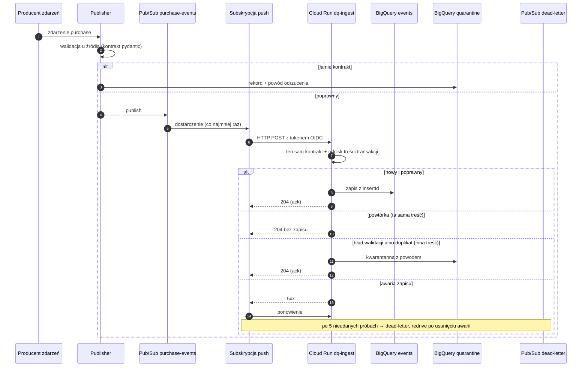

# Diagram sekwencji UML: zdarzenie → walidacja → BigQuery albo kwarantanna

Pipeline streamingowy: kto wywołuje kogo i co się dzieje przy błędzie walidacji, powtórce i awarii zapisu. Pipeline batchowy i reguły kontraktu: [README](README.md).

| Krok | Kto | Po co |
|---|---|---|
| 2–3 | producent danych | błędny rekord nie wchodzi do transportu |
| 7 | usługa ingest | drugi raz ten sam kontrakt: dane mogą przyjść spoza publishera |
| 8–9 | usługa ingest | zapis przed 204 — awaria nie gubi rekordu |
| 10–12 | usługa ingest | powtórka bez duplikatu, a konflikt widać w kwarantannie |
| 13–14 | Pub/Sub | ponowienia i dead-letter zamiast utraty zdarzenia |
